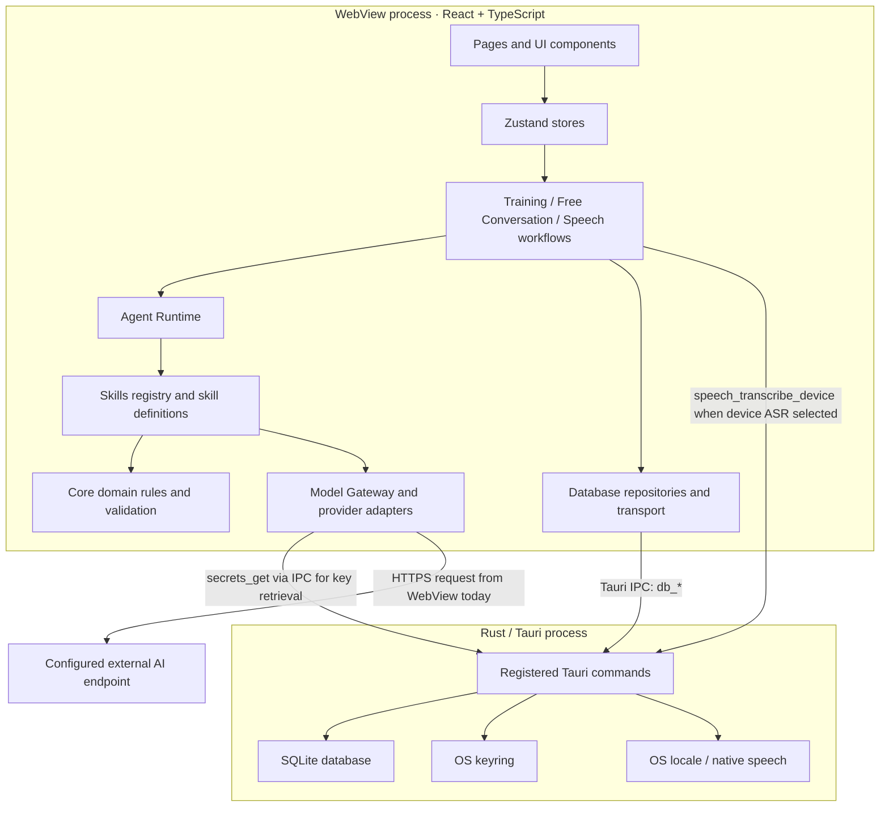
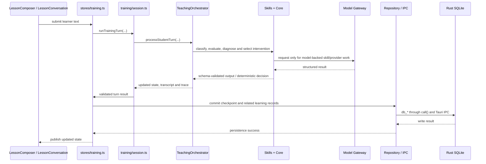
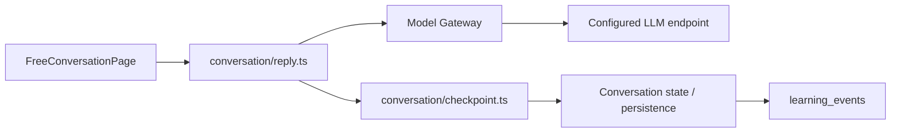
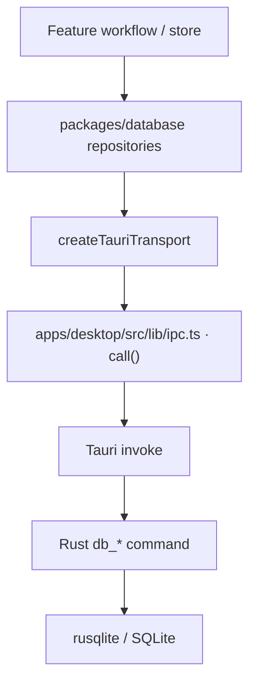

# System Architecture

Status: implemented architecture reference (maintain alongside code).

This document describes the architecture currently implemented on `main`.
It complements rather than replaces the ADRs: this page explains the system
shape and runtime flows; ADRs explain why individual decisions were made.
When code and this document disagree, verify the code and update this page in
the same change.

## 1. System at a glance

Sayden is a local-first desktop application. It has two runtime processes and
no separate cloud business backend:

- **WebView process**: React + TypeScript UI, Zustand application state,
  teaching workflows, Agent/Skill orchestration, model providers and database
  repositories. The WebView has no Node.js runtime.
- **Rust/Tauri process**: narrow native capability boundary, SQLite connection
  and migrations, OS keyring access, system locale and native speech recognition.
- **External provider**: optional OpenAI-compatible LLM/ASR/TTS endpoint. The
  current connected model path is initiated by the WebView Model Gateway; it
  is not yet proxied through Rust.

The package dependency direction is intentionally layered:

| Area | Main location | Responsibility |
| --- | --- | --- |
| Desktop composition | `apps/desktop/src/App.tsx`, `pages/` | Page composition and navigation |
| Application state | `apps/desktop/src/stores/` | UI-facing state and user actions |
| Application workflows | `training/`, `conversation/`, `speech/` | Orchestrate one user-visible operation |
| Agent orchestration | `packages/agent-runtime/` | Execute a teaching turn and emit trace/events |
| Skills | `packages/skills/` | Bounded AI or deterministic capabilities with validated contracts |
| Domain rules | `packages/core/` | Deterministic assessment, evidence and teaching policy |
| AI abstraction | `packages/model-gateway/` | LLM/ASR/TTS interfaces, provider adapters and errors |
| Learning memory | `packages/memory/` | Derive, validate and reuse learner memory |
| Data access | `packages/database/` | Schemas, repositories and transport abstraction |
| Native boundary | `apps/desktop/src-tauri/src/` | SQLite, keyring and OS capabilities |
| Shipped product content | `content/` | Versioned scenario/course assets, not learner records |

`packages/*` remain framework-free. The desktop app composes them; the Rust
process owns privileged OS/database operations.

## 2. Runtime boundaries and data ownership

### WebView

The WebView owns presentation and application orchestration. It may hold
in-memory UI state and transient request data, but it must not persist provider
keys in localStorage, IndexedDB or ordinary files. All Tauri IPC initiated by
frontend application code must use `apps/desktop/src/lib/ipc.ts` and its
`call()` wrapper so failures become a consistent `IpcError`.

### Rust/Tauri

`apps/desktop/src-tauri/src/lib.rs` registers the native command surface and
initializes the database at startup. `db.rs` owns the SQLite connection and
database commands; `secrets.rs` owns keyring operations; `locale.rs` reads
system locale; `speech_recognition.rs` provides device speech transcription.

The currently registered command groups are:

| Group | Commands | Purpose |
| --- | --- | --- |
| Health | `health_check` | Verify the IPC bridge |
| Database | `db_select`, `db_execute`, `db_status`, `db_backup`, `db_restore` | Parameterized SQLite access, status and backup/restore |
| Secrets | `secrets_set`, `secrets_get`, `secrets_delete` | Allowlisted OS-keyring access |
| Locale | `get_system_locale` | Read OS language and regional settings |
| Device speech | `speech_transcribe_device` | Native speech recognition path |

The command list above is the registered surface in `lib.rs`. Keep it aligned
when commands are added, removed or renamed.

### Data ownership

- `content/` contains shipped, versioned product assets. Startup sync projects
  scenario metadata into SQLite using slug-based upsert semantics.
- SQLite in the app data directory contains learner profiles, lesson/session
  data, checkpoints, memory, review and other local user data.
- API credentials live in the OS keyring and are addressed by allowlisted,
  endpoint-scoped names.
- Audio recordings and raw voice-recognition drafts are transient; only
  learner-confirmed transcript text can enter a submitted learning turn.

## 3. Key runtime flows

### 3.1 Training: one text turn

The following is the logical path for a normal learner text turn. Not every
skill calls a model: domain policy and validation remain deterministic where
possible.

Key implementation locations:

1. `apps/desktop/src/components/LessonComposer.tsx` collects the learner input.
2. `apps/desktop/src/stores/training.ts` owns the UI action and publishes state
   only after the operation/persistence path succeeds.
3. `apps/desktop/src/training/session.ts` coordinates a training turn.
4. `packages/agent-runtime/src/orchestrator.ts` implements
   `processStudentTurn()`, builds context and coordinates skill execution.
5. `packages/skills/src/registry.ts` and `definitions/*.ts` register and
   implement capabilities. Skill contracts validate inputs/outputs.
6. `packages/core/src/*.ts` (package source modules) enforce deterministic
   evidence, assessment and intervention rules.
7. `packages/model-gateway/src/` abstracts providers; it is used by
   model-backed skills, not by every deterministic rule.
8. `packages/database/src/repositories.ts` validates/mutates domain records;
   `transport.ts` bridges repositories to Tauri commands.
9. Rust `db.rs` executes parameterized SQL against the local SQLite file.

Training state is prepared as a private operation draft. The canonical
versioned `training_checkpoint` aggregate is saved atomically in the existing
`learning_events` table together with its related learning-memory contribution
where applicable. The UI should not publish an uncommitted turn as saved.
When a validated write fails, the retry path can retry persistence without
asking the model to generate the turn again. See ADR-0009 and ADR-0014.

### 3.2 Free Conversation

Free Conversation is a separate application workflow rather than a mode flag
inside the Training teaching loop:

It builds a bounded recent-conversation context plus selected learning
observations, validates the reply/evidence, and persists the conversation
checkpoint and memory projection. Do not assume a Training-only change affects
Free Conversation.

### 3.3 Voice input and reply playback

Voice is a set of coordinated workflows, not one native-only feature:

- Capture/recording is initiated in the WebView through
  `speech/capture.ts` and browser media APIs.
- ASR provider selection is injected into the capture workflow. The configured
  OpenAI-compatible ASR adapter uses Model Gateway and makes a provider request
  from the WebView; the device recognition option invokes
  `speech_transcribe_device` through Rust IPC.
- The learner reviews and confirms the transcript before it is submitted to
  Training or Free Conversation. Unconfirmed draft text is not learning evidence.
- Playback in `speech/playback.ts` uses an installed system voice or a
  configured TTS provider. Provider TTS currently follows the WebView Gateway
  route.

See ADR-0017 and `docs/development/VOICE_LOOP.md` for limits and physical-device
verification requirements.

## 4. Database path, startup, backup and restore

### Repository-to-SQLite path

Repositories are the only TypeScript layer that owns SQL strings. They map
snake_case rows to camelCase and validate returned records with Zod. The
transport is injected, allowing repository tests to use a fake without Tauri.

### Startup

1. Tauri setup calls `init_database()` in `src-tauri/src/lib.rs`.
2. Rust resolves the app-specific data directory and opens
   `language-lab.db`.
3. Rust creates/checks the migration journal and applies pending migrations.
4. Before a migration on an existing database, Rust creates a timestamped
   SQLite online backup and prunes old backups to the configured retention.
5. The database handle is managed by the Tauri application state.
6. Frontend startup loads bundled scenario content and syncs its metadata
   projection through the repository/IPC path.

### Backup and restore

- `db_backup` uses SQLite's online backup API and writes a consistent database
  backup under the app data directory.
- `db_restore` is a Rust command and is the only supported application restore
  boundary; callers should not manipulate the live database file directly.
- Migration backups are separate timestamped pre-migration backups. The Rust
  implementation currently retains the latest three backup files.
- Database schema changes require a new versioned SQL migration and updates to
  the migration registration/schema journal, plus compatibility tests. Never
  edit an already shipped migration.

## 5. Model requests and credential boundary

Current connected Training flow:

1. `apps/desktop/src/training/gateway.ts` reads the configured endpoint-scoped
   key using `call("secrets_get", ...)`.
2. Rust `secrets_get` retrieves the credential from the OS keyring.
3. The key is injected into an OpenAI-compatible provider instance in the
   WebView Model Gateway.
4. The provider sends the HTTPS request from the WebView to the configured
   endpoint. The key is not written to WebView storage.

This means **credential storage is native-protected, but outbound model traffic
is not yet uniformly proxied through Rust**. ADR-0002 records the intended Rust
proxy and explicitly permits this direct-provider fallback until that work is
implemented. Do not document the proxy as already shipped.

A Rust proxy should be treated as a separate security/architecture project.
Before implementing it, decide the supported provider protocol surface,
streaming/cancellation behavior, request/response size limits, proxy error
mapping, local endpoint support, certificate/network policy, and how ASR/TTS
share the transport. Reassess based on distribution model and threat model;
do not introduce it as incidental cleanup.

## 6. Change-impact guide

| Product change | Start here | Also inspect |
| --- | --- | --- |
| Message layout/actions | `components/LessonConversation.tsx`, `LessonComposer.tsx` | message action components, i18n, UI styles and E2E |
| Training turn behavior | `stores/training.ts`, `training/session.ts` | Agent Runtime, affected Skills, Core, checkpoint tests |
| Free Conversation behavior | `conversation/reply.ts` | checkpoint schema, gateway, persistence and tests |
| AI response style | `skills/definitions/dialogue-roleplay.ts` | prompt/context, output schema, orchestration tests |
| Objective completion/evidence | `objective-evaluator.ts` | `packages/core` assessment and evidence tests |
| Correction policy/timing | `teaching-intervention.ts` | Core intervention rules and delivery validation |
| Learner memory | `packages/memory` | Core evidence derivation, checkpoint and persistence |
| Add/edit course content | `content/scenarios/*.json` | content schema, catalog, content validation |
| Add a stored field | database schema/repository | SQL migration, Rust migration registry, compatibility tests |
| Add a model provider | `packages/model-gateway` | provider types, training/conversation gateway and settings |
| Voice capture/playback | `speech/capture.ts`, `speech/playback.ts` | provider adapters, speech settings, native-device tests |
| Native capability | Rust module + command registration | `src/lib/ipc.ts`, capability config and native tests |

## 7. Documentation maintenance

- Keep this file focused on system shape, process boundaries and key flows.
- Keep rationale and trade-offs in `docs/adr/`; link the relevant ADR rather
  than copying its full history here.
- Keep operational details and feature-specific behavior in
  `docs/development/`.
- When a task changes a runtime boundary, IPC command, persistence format,
  model transport or major workflow, update this document and the relevant ADR
  or development guide in the same change.
- Verify Mermaid diagrams render in GitHub and re-check file paths against the
  current tree when modules move.

---

## Scenario courses

Versioned scenario content now includes optional authored course templates with
roles, target expressions, ordered stages, success criteria and feedback budgets.
All shipped scenarios include this material; legacy metadata-only content remains
readable. Zod validates content and cross-references at the boundary; a published
JSON Schema supports authoring tools.

The scenario SQLite table continues to store its existing metadata projection.
Course content reaches the orchestrator through `ScenarioView.courseTemplate`;
`initLesson` compiles a configured copy into a validated `LessonState` snapshot.
Dialogue and deterministic interventions use this snapshot, so subsequent content
syncs cannot alter an in-progress course. No database schema changes are required.

The Scenarios page provides course previews, level/feedback configuration and
validated JSON import/export. Edits and imported previews are temporary until
exported to a file. Configured courses can now open directly in Training.
See [Scenario courses](../development/SCENARIO_COURSES.md).

The starter catalog orders static, validated course assets by learning goal.
The library renders those assets independently of startup seed synchronization.
SQLite continues to hold the metadata projection and additional local scenario
rows. See [ADR-0021](../adr/ADR-0021-ordered-starter-course-library.md).

Before a session exists, the Course Designer skill uses the configured model
gateway to turn a learner's goal into a version 1 scenario. It validates the
model payload and assigns objective references and policy in code. The result
opens in the usual preview and is snapshotted locally when the learner starts.
Built-in course packs remain available for first use and offline practice.
See [ADR-0019](../adr/ADR-0019-validated-ai-course-design.md).

## Free conversation

The learning plan opens a dedicated conversation with Zoi. The greeting is
local. Sending text or a confirmed transcript uses the saved AI connection
and endpoint-scoped keyring access through the same Model Gateway as Training.
The reply draft retains uncertain voice-derived wording in memory long enough
to ask for confirmation before a turn is submitted. A clear standalone topic
refusal gets a local acknowledgment through the usual save flow.
The request contains a bounded window of recent conversation and selected English
learning observations. The gateway validates the reply and optional evidence
against the learner's words. Each successful exchange commits a
`free_conversation_checkpoint` and `free_conversation_memory` together in
`learning_events`. The Memory page can reopen the transcript. Leaving the view
cancels a pending model reply and releases speech resources. See
[ADR-0014](../adr/ADR-0014-four-type-learning-memory.md).

## Text teaching loop

Training composes the single teaching orchestrator with either explicitly labelled
guided examples or connected AI skills. The objective evaluator returns criterion
judgments with exact learner citations. The core verifies coverage and references,
retains earlier verified evidence, and advances only a fully demonstrated stage.
The updated stage reaches dialogue generation in the same turn. A validated review
moves the last completed stage from debrief to done.

Input routing separates help, eligible answers and excluded dialogue before
committing evidence. An unfinished close or a reached turn limit renders a
deterministic summary from the existing checkpoint. When saving a validated
turn fails, the desktop can retry the same write without asking the model again.

The desktop processes each operation in a private draft. One SQLite upsert saves a
versioned `training_checkpoint` aggregate in the existing `learning_events` table,
including state, transcript, evidence, domain events and report. The UI publishes
the new session after that write succeeds. These aggregates are separate from the
existing normalized lesson/message projections; no database migration or Rust
command was added. API keys remain in the OS keyring, scoped by endpoint, and are
absent from checkpoints. See [ADR-0009](../adr/ADR-0009-grounded-objectives-and-training-checkpoints.md)
and [Teaching loop](../development/TEACHING_LOOP.md).

## Complete learning packs

Hotel Check-in adds an optional authored `learningPack`: preparation, vocabulary
meanings, scenario facts, model dialogue, per-stage guided material, variations and
independent review. Cross-references are validated at the content boundary.

A selected variation is recorded on the immutable source. A pure resolver
compiles its facts, stages, opening and guided prompts into the course snapshot;
the source remains editable and reusable for a different challenge. Saved-session
validation compares the snapshot with the resolved source, including after JSON
import/export. The same hotel facts reach dialogue and objective evaluation.

Independent review responses are optional learner data in the existing Training
checkpoint. Only a completed course's valid review-exercise ids are accepted.
Saving uses the same atomic upsert and failure behavior; database schema and Rust
commands are unchanged. See [Hotel Check-in](../development/HOTEL_CHECKIN.md).

## Dynamic role dialogue

Course snapshots may include an authored character profile. Reply generation uses
that profile, bounded recent dialogue, cited learner memory, current criteria and
the previous completed stage. The core validates memory updates against actual
learner practice messages and preserves at most 12 details in the existing state.
Learner statements remain distinct from authoritative scenario facts.

Help controls and recognised standalone English requests follow a separate
support path: no diagnosis, vocabulary tracking or objective evaluation. Saved
support messages cannot serve as completion evidence or memory; reviews exclude
them. Hints obey the existing budget, while exact repeat needs no model. A single
duplicate-response repair attempt is allowed before the operation fails safely.
All state, support markers and memory use the existing atomic checkpoint.
See [ADR-0010](../adr/ADR-0010-dialogue-memory-and-support-requests.md) and
[Dialogue Roleplay](../development/DIALOGUE_ROLEPLAY.md).

## Deterministic vocabulary observations

A pure core matcher now supplies the vocabulary skill, transcript replay and
Training progress display. Unicode-aware normalization and lexical boundaries
recognise exact targets plus explicitly authored course forms. Matches retain
original UTF-16 spans; no model, fuzzy inference or dictionary service is used.
Counters record practice turns containing a target, with occurrences and latest
evidence derived separately. Partner/system/help messages cannot contribute, and
lexical use never establishes mastery or completes an objective.

An optional `vocabularyTrackingVersion` marker in Training checkpoints verifies
counts against transcript evidence on restore. Legacy totals are replayed only
in the private operation draft, then committed atomically with the next successful
turn/review. Content snapshots retain their own accepted forms. No database or
IPC changes are needed. See [ADR-0011](../adr/ADR-0011-deterministic-vocabulary-observations.md)
and [Vocabulary Tracker](../development/VOCABULARY_TRACKER.md).

## Grounded language diagnosis

The model diagnosis skill receives bounded context but may cite only the current
learner reply. Core validation requires exact original spans, meaningful changes,
non-overlapping suggestions and preserved numeric sequences. Declared uncertain
suggestions are withheld; invalid schema/evidence permits one bounded repair.
An English suggestion that alters explicit negation markers is also withheld.
Voice transcription confirmation happens before this post-send language check.
Text-derived fluency is `not_assessed` and cannot trigger automatic fluency hints.

Free Conversation and Training share a message verdict. A grounded expression
improvement is stored with the learner reply and its assessment time. Actual
errors drive recasts, error memory and review. A language assessment failure
leaves the message unassessed, and Training can display confirmed issues on
demand even when the proactive recast is deferred.

Deterministic teaching policy chooses one validated priority correction within
the existing limits. Optional per-practice diagnosis records preserve the accepted
observations and the delivered correction reference in the atomic checkpoint;
restore verifies their citations and delivery consistency. Help messages remain
excluded, original learner text remains intact, and review receives the same
source/uncertainty information. No SQL or IPC changes are required. See
[ADR-0012](../adr/ADR-0012-grounded-language-diagnosis.md) and
[Error Diagnosis](../development/ERROR_DIAGNOSIS.md).

## Gentle intervention timing and delivery

Shared core rules choose one short correction within lesson limits, leave
configurable practice intervals and suppress exact recent reminders. Optional
versioned intervention state persists practice positions and bounded delivery
marks. Training reconstructs it from actual practice and recorded corrections;
support exchanges do not advance the interval. Legacy known history is seeded
privately while preserving budgets.

Dialogue receives one approved structured correction. Its reply must include
the corrected expression and stay within a brief-response limit; one combined
repair is allowed. The orchestrator verifies delivery before counting it, and the
atomic checkpoint saves reply, history and reason together. Explanations become
optional in feedback. No SQL or IPC changes are needed. See
[ADR-0013](../adr/ADR-0013-gentle-intervention-timing-and-delivery.md) and
[Teaching Intervention](../development/TEACHING_INTERVENTION.md).

## Four-type learning memory

The memory package validates explicit profile preferences and structured lesson
contributions. Training derives knowledge/error observations and episode facts
from saved learner evidence, keeping supported practice separate from model
observations. Global memory replaces each lesson's contribution; use and diagnosis
counts never automatically establish mastery or an assessed profile level.

A single SQLite multi-row UPSERT now commits the canonical Training checkpoint
and a compact `learning_memory_contribution` row together. Profile edits use a
single profile UPSERT. Both use existing tables and IPC, with no migration. Reads
filter learner/type and page all memory sources beyond the 50-lesson resume list;
legacy checkpoints are derived without silent rewrites. The Memory page exposes
four categories, profile editing and exact source-lesson opening. Teaching receives
a bounded language-scoped view while current course facts and criteria remain
authoritative. See [ADR-0014](../adr/ADR-0014-four-type-learning-memory.md) and
[Learning Memory](../development/LEARNING_MEMORY.md).

## Evidence-based post-lesson reports

Core derives a versioned recap from the completed course snapshot, exact stage
citations, deterministic learner vocabulary matches and saved diagnosis records.
Training saves this with model commentary and the atomic checkpoint/memory pair;
restore recomputes the facts and tasks. Legacy completed sources are reconstructed
without rewriting them. Support requests, partial diagnosis coverage and legacy
delivery flags retain their provenance instead of implying independent mastery.

Training and Reports share a report view. Reports reads all completed episodes,
loads individual source checkpoints without replacing active practice, and saves
bounded personal reflection separately from evidence. Next tasks come from known
issues, unused vocabulary and authored review exercises. Model commentary and its
subjective score are explicitly separated from lesson facts. No new database,
IPC or dependency edges are introduced. See
[ADR-0015](../adr/ADR-0015-evidence-based-learning-reports.md) and
[Learning Report](../development/LEARNING_REPORT.md).

## Targeted follow-up review

The registered Review Generator now derives bounded typed practice from completed
course evidence, using the same deterministic core rules in AI and demo modes.
It selects recurring short diagnosis patterns, unused words and contextual
transfer practice, retaining exact source/uncertainty and authored examples.
Suggested dates and self-reported completion are distinct from assessed mastery.

An optional versioned `reviewPlan` lives in the canonical Training checkpoint.
The existing multi-row SQLite UPSERT co-commits it, its queue mirror and the
memory contribution atomically. Paginated learner/type-filtered queue reads are
independent of the latest-50 resume window; opening or saving a task validates
the original source. Source-grounded targets are replay-validated, while personal
attempts keep bounded history, deterministic check results and optional example
support without rewriting original teaching evidence. The Review page supports
due/upcoming/practised views, answers, self-check, retry and source opening. Legacy
plans generate explicitly and idempotently. No schema migration, IPC or dependency
edge changes are needed. See
[ADR-0016](../adr/ADR-0016-targeted-follow-up-review.md) and
[Review Generator](../development/REVIEW_GENERATOR.md).

## Contextual speaking practice

Free Conversation and Training can request a contextual example separately from
ordinary turns. An optional versioned checkpoint section links the shown example,
the next eligible learner reply and a new situation. The existing teaching loop
still produces the normal partner reply. Transfer tasks have their own validated
criteria and results, can also use authored offline material, and persist on their
original source with the learning-memory index. The memory setting and source
deletion govern historical recommendations. See
[Contextual speaking practice](../development/CONTEXTUAL_SPEAKING_PRACTICE.md).

## Confirmed voice input and reply playback

OpenAI-compatible ASR/TTS adapters now implement the existing Model Gateway audio
interfaces with bounded bodies, full-call deadlines, cancellation and sanitized
errors. Nonsecret speech settings use a learner-scoped SQLite event; credentials
remain in separate endpoint-scoped OS keyring entries. The direct-fetch fallback
in ADR-0002 remains in effect and requires provider CORS support.

Training captures audio on explicit action, negotiates the platform's supported
MediaRecorder format and shows an editable recognition preview before the learner
adds it to the composer and sends it. Only confirmed words enter teaching and
the atomic checkpoint. Optional speech provenance is backward compatible and
cannot establish pronunciation, oral fluency or mastery. Audio and raw recognition
drafts are never persisted. Track/resource cleanup and generation guards prevent
late microphone, recognition or playback results crossing lesson/navigation
boundaries. Reply reading uses matching installed local voices or configured MP3
TTS; opt-in automatic reading occurs only after successful saves. See
[ADR-0017](../adr/ADR-0017-confirmed-speech-and-reply-playback.md) and
[Voice loop](../development/VOICE_LOOP.md) for native permission configuration,
transport limits and the required physical-device validation matrix.

Playback resolves a character's optional voice style and known name against the
learner's voice preference. It then selects an installed same-language device
voice or a compatible provider voice ID. Older course and speech preference
payloads stay readable. See [ADR-0020](../adr/ADR-0020-character-voice-selection.md).

## Interface language and region

Rust reads preferred OS UI language and independent regional settings through
`get_system_locale`; the validated frontend locale store combines them with a
versioned manual/system preference in the existing `learning_events` table.
i18next resources rerender all current pages without changing learning state.
The interface supports simplified Chinese, traditional Chinese and English, with
English fallback for unsupported languages. UI locale never changes course,
teaching prompts, profile or speech-language inputs. On-demand message
translation uses the active UI locale and sends only the selected message to
the configured provider when it needs a model. See
[ADR-0018](../adr/ADR-0018-system-locale-interface-language.md).
